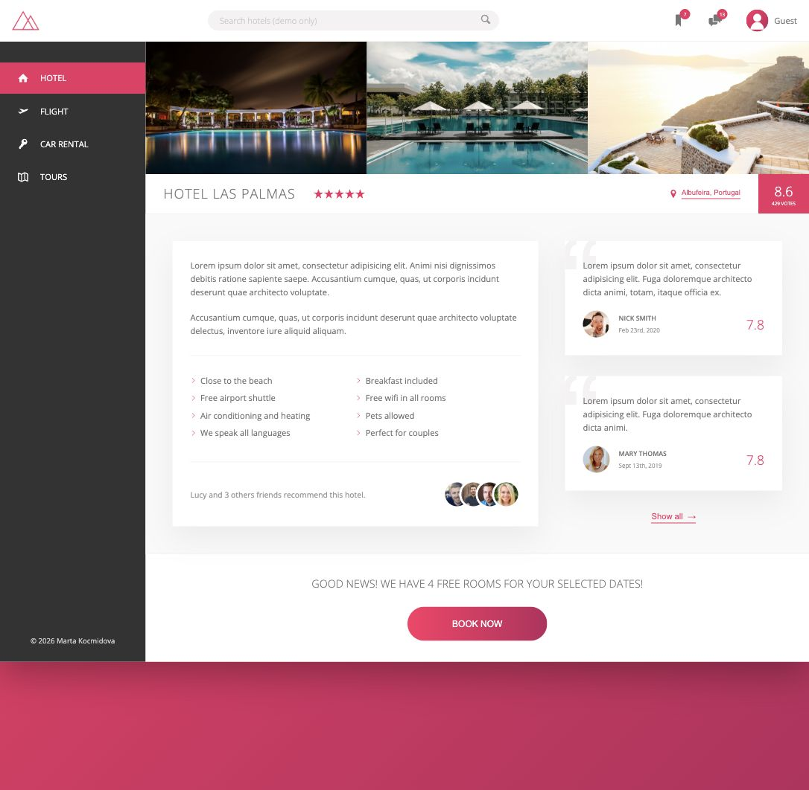

# Trillo

Responsive hotel booking interface built as a CSS and Sass portfolio project.

[View the live demo](https://kocmidovam.github.io/Trillo/)



## About

Trillo is a static UI concept focused on responsive layout, reusable Sass
components, animations, and polished visual states. Search, navigation, profile
actions, and booking controls are intentionally presented as non-functional
demo controls.

The original layout concept was created while following Jonas Schmedtmann's
Advanced CSS and Sass course. I extended the project with custom mobile
breakpoints, interactive gallery states, and a profile dropdown.

## Highlights

- Responsive flexbox layout for desktop, tablet, and mobile
- Component-based Sass structure
- Animated gallery, navigation, and call-to-action states
- Keyboard-visible focus styles and reduced-motion support
- SVG icon sprite and responsive image presentation

## Run locally

```bash
npm install
npm start
```

Build the production CSS:

```bash
npm run build:css
```

## Tech stack

HTML5, Sass, Flexbox, PostCSS, and Autoprefixer.
